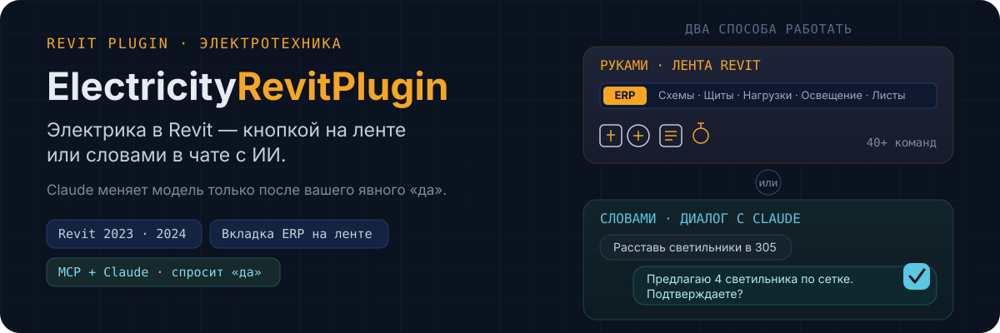
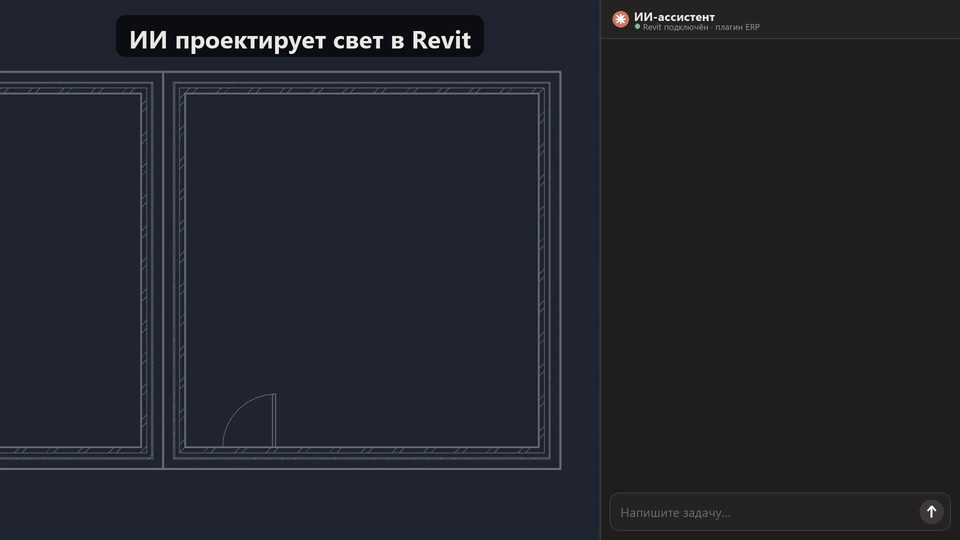
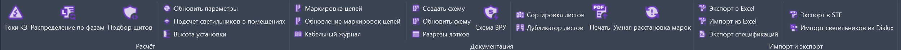
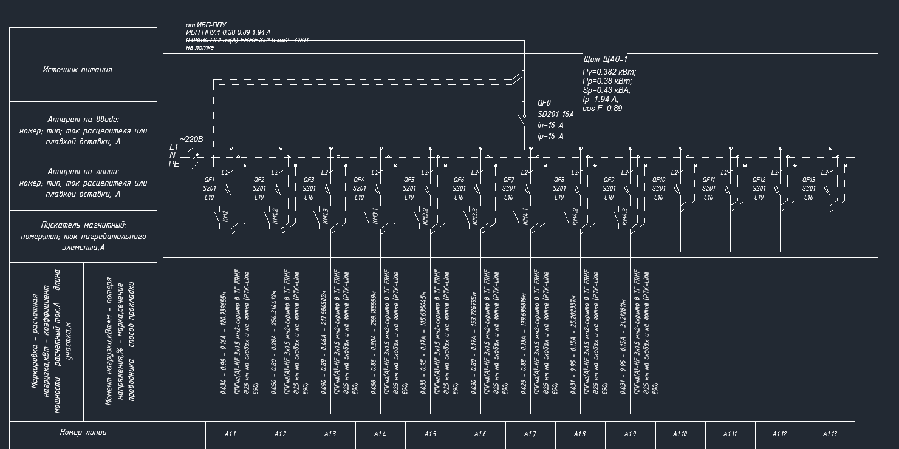

# ERP — электрика (ЭОМ) в Revit: 40+ инструментов и ИИ-проектирование освещения

[](https://www.autodesk.com/products/revit)
[](https://dotnet.microsoft.com/download/dotnet-framework)
[](https://github.com/Evgivachev/erp-public/releases)
[](LICENSE)

<p align="center">
  
</p>

<p align="center">
  
  <br><sub>«Сделай свет в 116»: Claude находит кабинет, расставляет светильники и ставит выключатель у двери</sub>
</p>

**ElectricityRevitPlugin (ERP)** — плагин для инженеров-электриков: светильники, цепи, щиты, схемы, спецификации
и ещё десятки инструментов — там, где вы уже работаете, в Revit. А через
Claude и протокол MCP та же модель открывается для диалога: опишите задачу
своими словами — и ИИ сделает расстановку, расчёт и подключение сам,
спрашивая подтверждение перед каждым изменением.

## Два способа работать

**Руками, как обычно.** Вкладка **ERP** на ленте Revit — маркировка цепей,
кабельный журнал, расчёт токов КЗ, однолинейные схемы щитов, экспорт в Excel
и Dialux, спецификации, печать. Всё то, что вы делали раньше, только быстрее.
→ [Список команд на ленте](docs/ribbon-commands.md)

<p align="center">
  
</p>

<p align="center">
  
  <br><sub>Однолинейная схема щита — строится и обновляется по модели одной командой</sub>
</p>

**В диалоге с ИИ.** Подключите Claude к модели через MCP — и проектирование
освещения превращается в разговор:

```
Вы:     Расставь светильники в переговорной 305, у двери повесь выключатель
Claude: Нашёл помещение 305 — 18 м², целевая освещённость 300 лк (переговорная).
        Предлагаю 4 светильника 595×595 по сетке. Подтверждаете?
Вы:     Да
Claude: Готово, создал 4 светильника и выключатель. Нашёл щит ЩО-1.2 рядом —
        подключить эти 4 светильника к нему? Свободный запас цепи — 62%.
Вы:     Подключай
Claude: Подключено. Итоговая нагрузка цепи — 38%. Скриншот результата приложил.
```

Claude видит помещения, светильники, щиты и цепи в реальном времени и меняет
модель только после вашего явного «да». → [Как подключить и что можно попросить](docs/ai-assistant-usage.md)

## Подстраивается под ваш шаблон, а не диктует свой

Плагин не завязан на конкретные семейства или зашитые имена параметров — он
работает с тем, что реально есть в вашем проекте:

- **Параметры** — читает и записывает значения по имени, включая ваши
  собственные параметры, а не только встроенные параметры Revit
- **Семейства** — подбирает светильники и выключатели из тех типоразмеров,
  что уже загружены в проект, а не навязывает свои
- **Расположение** — создаёт, перемещает и точно позиционирует элементы —
  и вручную кликом на ленте, и словами через ИИ

Поэтому одинаково хорошо работает и с типовым шаблоном ЭОМ, и с шаблоном,
который годами настраивался под конкретную компанию — подходит любому
проекту, без переделки модели под инструмент.

## Что уже умеет ИИ-режим

- Анализировать помещения и подбирать освещённость по нормам (СП 52.13330)
- Рассчитывать и расставлять светильники равномерной сеткой
- Ставить выключатели у дверей и привязывать к светильникам
- Находить подходящий щит и цепь по нагрузке, расстоянию и запасу
- Подключать к существующей цепи или предлагать новую с нужным номиналом

Это только первый набор возможностей — плагин развивается, и через MCP
Claude постепенно получает всё больше «рук» для работы с моделью: чем больше
инструментов открыто, тем более сложные задачи можно доверить диалогу с ИИ.

## Быстрый старт

1. Откройте [последнюю стабильную версию](../../releases/latest) и скачайте
   файл под свой Revit: `..._R23_...` — для Revit 2023, `..._R24_...` — для Revit 2024.
   - **ZIP** — проще всего: распакуйте и запустите `Install.bat` от имени администратора.
   - **MSI** — обычный мастер установки.
2. Откройте Revit — на ленте появится вкладка **ERP**.
3. Скачайте [шаблон проекта](https://electroprorevit.tilda.ws/) — с ним
   инструменты работают сразу, без настройки.

> **Стабильная или бета?** Версия с меткой *Latest* — стабильная, её
> советуем для работы. Версии с пометкой *Pre-release* (beta) — свежие
> функции раньше всех, если хочется попробовать новое. После установки
> плагин сам обновляется при старте Revit.

Хотите сразу подключить ИИ — переходите к [настройке MCP](docs/mcp-setup.md).
Не хотите разбираться сами — пришлите ссылку на эту страницу в чат с Claude
Code и попросите подключить: там есть раздел специально для Claude, он
справится сам.

## Что понадобится для ИИ-режима

Кнопки на ленте работают сами по себе — ИИ для них не нужен. Для диалога
с моделью дополнительно нужны:

- Claude Desktop или Claude Code (аккаунт Claude)
- .NET Runtime 8 (x64)
- Вход в аккаунт ERP — при первом обращении Claude покажет ссылку и код,
  дальше вход запоминается

Подробно — в [подключении MCP](docs/mcp-setup.md).

## Документация

- [Установка и настройка](docs/installation.md) — системные требования, автообновление, удаление
- [Команды на ленте](docs/ribbon-commands.md) — обычная работа руками
- [Подключение MCP](docs/mcp-setup.md) — как связать плагин с Claude
- [Работа через ИИ](docs/ai-assistant-usage.md) — методика, примеры запросов, правила безопасности

## Вопросы и обратная связь

- Нашли баг — [заведите issue](../../issues)
- Есть вопрос или идея — пишите в [обсуждения](../../discussions)

## Лицензия

Документация и skill для Claude в этом репозитории распространяются по
лицензии MIT — см. [LICENSE](LICENSE). Сам плагин поставляется готовыми
установщиками на странице [Releases](../../releases).
